  

I build software where **machine learning**, **numerical computing**, and **backend infrastructure** meet. My work ranges from experimenting with integer-only neural-network training to distributed ML systems and practical tools for developers.

**Main tools:** Rust · Python · PyTorch · Kubernetes · Linux · CUDA

[**Selected work**](#selected-work) · [**Portfolio**](https://blog.godesteem.de/portfolio/) · [**Engineering notes**](https://blog.godesteem.de) · [**Hugging Face**](https://huggingface.co/philipp-zettl) · [**CV**](https://github.com/philsupertramp/philsupertramp/releases/latest/download/cv.pdf) · [**Contact**](mailto:philipp@godesteem.de)

## Selected work

`$ ls ~/projects`

<table>
  <tr>
    <td width="50%" valign="top">
      <h3><a href="https://github.com/philsupertramp/integers">01 / integers</a></h3>
      Rust · Numerical computing · Machine learning
      
Exploring neural-network training and inference with fixed-point integer arithmetic, stochastic rounding, and CPU-oriented kernels. <em>Experimental / work in progress.</em>

    </td>
    <td width="50%" valign="top">
      <h3><a href="https://github.com/learn-dis/learn-dis">02 / learn-dis</a></h3>
      Python · PyTorch · Distributed systems
      
A framework for federated-learning experiments, including client/server training, dataset sharding, persistent tasks, and FedAvg aggregation.

    </td>
  </tr>
  <tr>
    <td valign="top">
      <h3><a href="https://github.com/philsupertramp/chain-smoker">03 / chain-smoker</a></h3>
      Python · API testing · Developer tooling
      
Record and run API smoke tests using declarative test cases; includes a proxy-based test-case capture workflow.

    </td>
    <td valign="top">
      <h3><a href="https://github.com/philsupertramp/factory">04 / factory</a></h3>
      Python · Model serving · Inference
      
A unified REST interface for experimenting with generative-model pipelines across text, speech, and images.

    </td>
  </tr>
</table>

## `$ cat /var/log/engineering.log`

I prefer sharing the actual work over achievement counters. These links are live views of development in the public repositories above:

- [**Integer-only ML experiments and active pull requests**](https://github.com/philsupertramp/integers/pulls)
- [**Recent chain-smoker changes**](https://github.com/philsupertramp/chain-smoker/commits)
- [**Distributed learning discussions and development**](https://github.com/learn-dis/learn-dis/pulls)

A generated changelog with selected public changes can replace this section later. For now it deliberately needs no scheduled GitHub Actions jobs or external stats service.

## `$ cat ~/background.md`

My background combines mathematics and software engineering. I completed a B.Sc. in Mathematics, researched [insect localization and classification from images](https://github.com/philsupertramp/inet) for my thesis, and taught an introductory machine-learning class at Berliner Hochschule für Technik in 2023.

I also write and tinker outside of ML: backend systems, developer tooling, Linux infrastructure, and the occasional side experiment.

<b>More projects, research, and credentials</b>

### Earlier projects

- [game-math](https://github.com/philsupertramp/game-math) — mathematical tools for game developers.
- [django-data-migration](https://github.com/philsupertramp/django-data-migration) — separating data migrations from schema migrations.
- [docr](https://github.com/philsupertramp/docr) — utilities around Docker Compose.
- [Insect localization & classification](https://github.com/philsupertramp/inet) — bachelor thesis, research, and accompanying code.

### Selected Hugging Face learning certificates

[View certificates in this repository](https://github.com/philsupertramp/philsupertramp/tree/main/certificates), including work on fine-tuning, post-training, vision-language models, and agents.

---

**Find me:** [GitHub](https://github.com/philsupertramp) · [Hugging Face](https://huggingface.co/philipp-zettl) · [Blog](https://blog.godesteem.de) · [Email](mailto:philipp@godesteem.de)